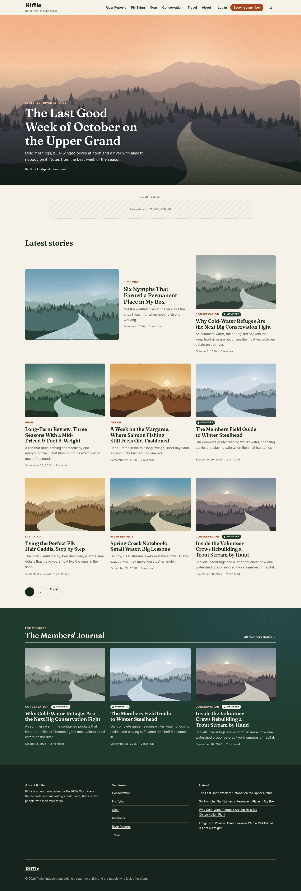
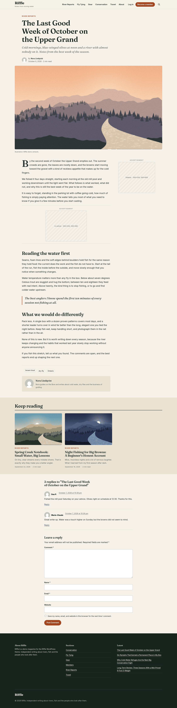
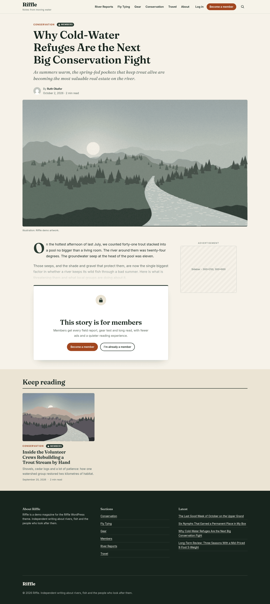

# Riffle

A hand-built WordPress theme for outdoors and fishing magazines.

Riffle is a classic PHP theme I wrote from scratch to show how I approach a publisher's WordPress site: an editorial front page, a members-only content gate, analytics and ad slots wired in properly, and markup that holds up for keyboard and screen reader users. No page builder, no starter theme, no framework. Just WordPress APIs used the way they are meant to be used.

All stories, authors and illustrations in the demo are made up.

**Live demo:** [Open in WordPress Playground](https://playground.wordpress.net/?blueprint-url=https://raw.githubusercontent.com/mryan-code/riffle-wp-theme/main/blueprint.json) (spins up a real WordPress in your browser, takes about 20 seconds)



## Highlights

### Editorial layout
- Front page with a featured story hero (newest sticky post, else newest post, filterable with `riffle_hero_post_id`), a "Latest stories" grid with a two-column lead card, and a dark "Members' Journal" band.
- The hero is removed from the main query in `pre_get_posts`, so it never repeats in the grid and pagination stays correct.
- Single story template with kicker, dek, byline, reading time, captioned feature image, drop cap, tags, author box, related stories and threaded comments.
- Templates for archives, search, 404 and pages, plus reusable template parts for cards, the hero, results, pagination and the author box.

### Members-only content gate (`inc/members.php`)
- A post is gated when it has the `_riffle_members_only` flag (meta box in the editor, also exposed in the REST API) or sits in the `members` category.
- Logged-out readers get the first two paragraphs, a soft fade and a join / log-in call to action. The rest of the story never leaves the server.
- The gate also covers the RSS feed and the REST API, which is where paywalls usually leak.
- Prints `isAccessibleForFree: false` structured data so Google treats it as a paywall, not cloaking.
- Access is one filter away from any membership system:

```php
add_filter( 'riffle_user_has_access', function ( $has_access, $user_id, $post ) {
	return my_membership_is_active( $user_id ); // MemberPress, RCP, Stripe, etc.
}, 10, 3 );
```

Other hooks: `riffle_is_members_only`, `riffle_members_category`, `riffle_teaser_paragraphs`, `riffle_members_join_url`.

### Analytics (`inc/analytics.php`)
- GA4 measurement ID or GTM container ID in the Customizer, validated against strict patterns on save so nothing unexpected can end up in a script tag.
- Pushes page context to the `dataLayer` before any tag fires: page type, content group (section), author, publish date, members-only and unlocked state, guest vs. logged in. Filterable with `riffle_datalayer`.
- Skips editors and admins by default, and never fires in the Customizer preview.
- `assets/js/events.js` sends `members_gate_view` when the gate is actually seen and click events for anything with `data-riffle-event`.

### Advertising (`inc/ads.php`, `template-parts/ad-slot.php`)
- Google Publisher Tag slots (leaderboard, in-article, sidebar) defined in one filterable array with desktop and mobile size maps.
- `gpt.js` is not even requested until the first slot is about a screen away, then GPT lazy loading takes over.
- Space is reserved per slot so ads do not cause layout shift.
- The in-article slot is injected after the third paragraph of long, unlocked stories only.
- With no network code set, slots render as labelled placeholders for layout reviews (toggle in the Customizer).
- `riffle_show_ads` makes an ad-light experience for paying members a one-liner.

### Accessibility
- Skip link, proper landmarks, one `h1` per page and a heading outline that axe-core is happy with.
- Visible `:focus-visible` styles, 44px touch targets and colour pairs that meet WCAG AA.
- Disclosure buttons for the mobile menu and search use `aria-expanded`, close on Escape and return focus.
- Decorative card images are hidden from assistive tech so each story is announced once.
- Respects `prefers-reduced-motion`.

### Front-end
- Modern CSS: custom properties mapped to `theme.json` presets, CSS grid, fluid type with `clamp()`, no build step.
- `theme.json` sets the palette, type scale and layout widths so the block editor matches the front end.
- Self-hosted variable fonts (Fraunces and Inter, SIL OFL) with preload, so no third-party font requests.
- Three small vanilla JS files, all deferred. No jQuery.

### Code quality
- Escaping on output, sanitizing on input, nonces and capability checks on every save.
- Passes the full `WordPress` ruleset from WordPress Coding Standards 3 plus PHPCompatibility (PHP 7.4+). Run `phpcs` with the included `phpcs.xml.dist`.
- Translation ready (`riffle` text domain, `languages/riffle.pot` generated with WP-CLI).

## Screenshots

| Home | Story |
| --- | --- |
|  |  |

| Members-only story (logged out) | Mobile |
| --- | --- |
|  |  |

More in [`screens/`](screens/): category archive, search, 404, mobile gate and the open mobile menu.

## Run it

**In the browser:** use the Playground link above. You land logged out, so members stories show the gate. Log in at `/wp-admin` with `admin` / `password` to see them unlocked.

**Locally with Playground CLI:**

```bash
git clone https://github.com/mryan-code/riffle-wp-theme.git riffle
npx @wp-playground/cli server --mount=./riffle:/wordpress/wp-content/themes/riffle --blueprint=./riffle/blueprint.local.json
```

**In any WordPress install:** copy the folder to `wp-content/themes/riffle` and activate it. To load the demo content:

```bash
wp eval-file wp-content/themes/riffle/demo/seed.php
```

Then look under **Appearance > Customize > Riffle theme** for the analytics, advertising, membership and footer settings.

## Files

```
style.css            Theme header and all front-end styles
theme.json           Editor palette, typography and layout
functions.php        Loads the modules in /inc
inc/                 setup, enqueue, template tags, customizer, members, analytics, ads
template-parts/      card, hero, single, page, result, none, members gate, ad slot, pagination, author box
*.php                front-page, index, single, page, archive, search, 404, comments, header, footer, sidebar, searchform
assets/js/           navigation.js, ads.js, events.js
assets/fonts/        Fraunces and Inter (woff2, SIL OFL)
demo/                Demo content script and generated illustrations
blueprint.json       WordPress Playground demo
```

## Requirements

WordPress 6.5 or newer and PHP 7.4 or newer. Tested on WordPress 7.1 with PHP 8.4.

## License

GPL-2.0-or-later, like WordPress itself. Fonts are under the SIL Open Font License (see `assets/fonts/`).

Matt Ryan, St. Catharines, Ontario
